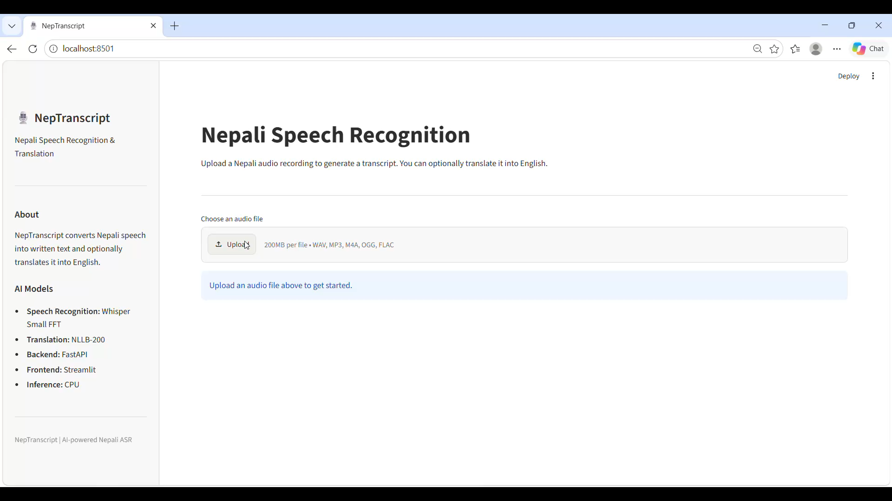
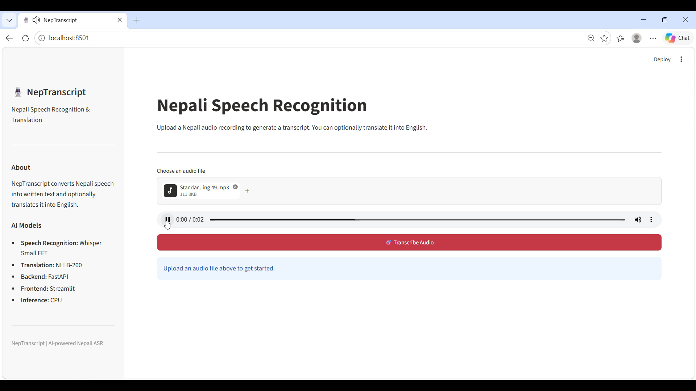
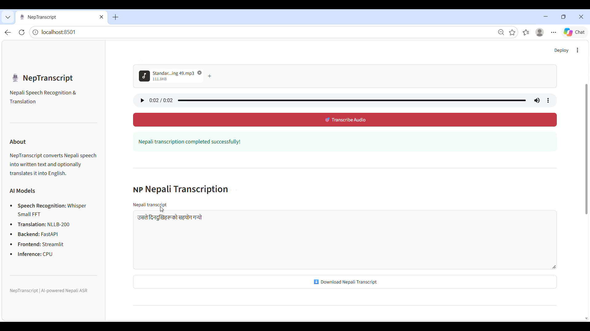
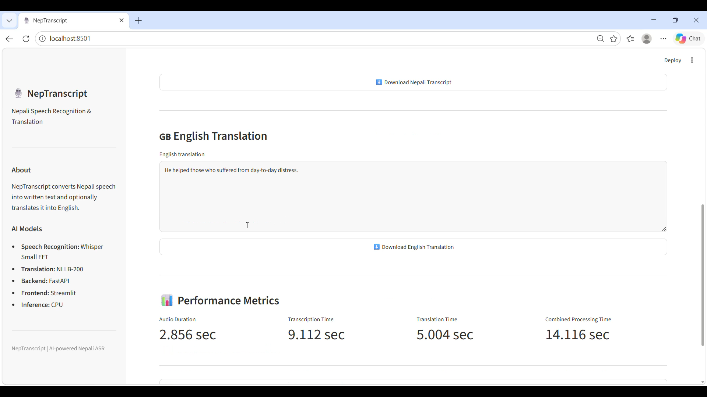
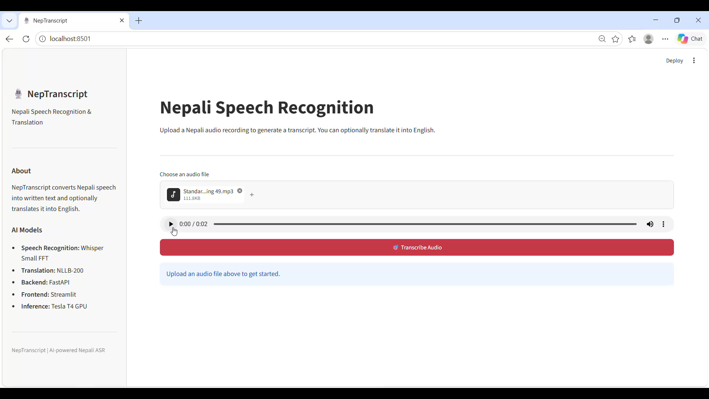
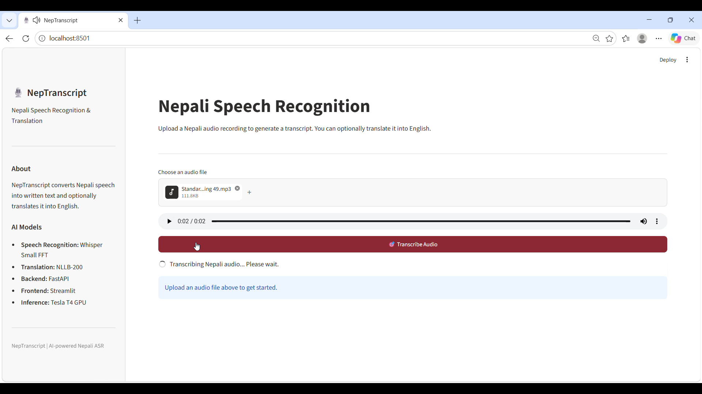
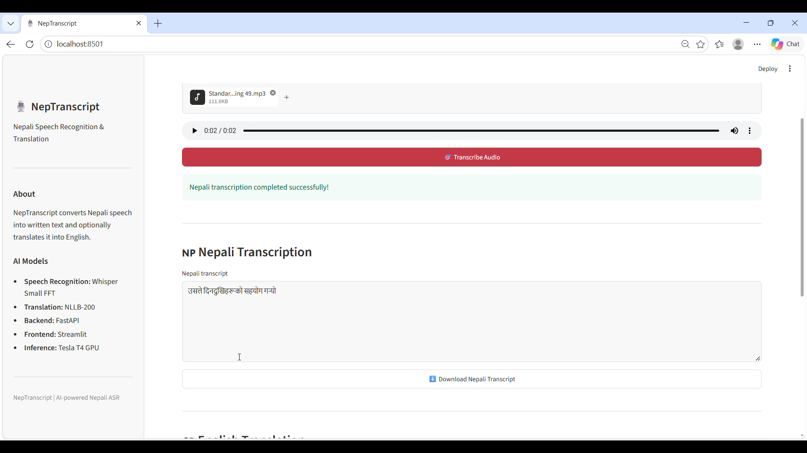
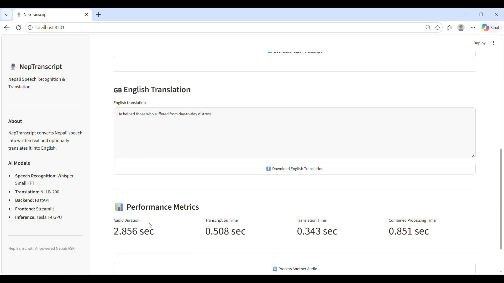

# 🎙️ NepTranscript

### Nepali Speech Recognition and Optional English Translation

NepTranscript is an AI-powered application that converts spoken Nepali audio into written Nepali text and optionally translates the transcription into English.

The system combines a fine-tuned OpenAI Whisper Small model for Nepali Automatic Speech Recognition (ASR) with Meta's NLLB-200 model for Nepali-to-English translation.

It provides a flexible inference architecture with a FastAPI backend and an interactive Streamlit web interface. Users can run inference locally using CPU or remotely using a GPU-powered Google Colab environment.

Users can first generate a Nepali transcript and then request an English translation separately.

## ✨ Features

- Nepali speech-to-text transcription.
- Optional Nepali-to-English translation.
- Fine-tuned Whisper Small model using Full Fine-Tuning (FFT).
- Comparison of Full Fine-Tuning and LoRA approaches.
- Local CPU-based inference.
- Remote GPU-based inference using Google Colab (NVIDIA Tesla T4).
- FastAPI backend for model inference.
- Interactive Streamlit frontend.
- Support for MP3, M4A, WAV, OGG, and FLAC audio formats.
- Audio preprocessing and format conversion using FFmpeg.
- Downloadable Nepali transcripts and English translations.
- Separate transcription and translation operations.
- Processing-time measurements for individual operations.

## 🏗️ System Architecture

NepTranscript supports two inference configurations: local CPU inference and remote GPU inference.

### 1. Local CPU Inference

In local inference mode, both the Streamlit frontend and FastAPI backend run on the user's computer.

```text
       Audio Upload
            |
            v
     Streamlit Frontend
            |
            v
      FastAPI Backend
            |
            v
    Audio Preprocessing
          FFmpeg
            |
            v
     Whisper Small FFT
            |
            v
      Nepali Transcript
            |
            v
      Streamlit Results
            |
            v
     Download Transcript
```

### 2. Remote GPU Inference

For GPU inference, the Streamlit frontend runs locally, while the FastAPI backend and fine-tuned models run in Google Colab using an NVIDIA Tesla T4 GPU.

```text
          Local Computer
        Streamlit Frontend
                |
                | HTTP Requests
                v
           ngrok Tunnel
                |
                v
           Google Colab
          FastAPI Backend
                |
                v
        Audio Preprocessing
              FFmpeg
                |
                v
          NVIDIA Tesla T4
                |
          +-----+-----+
          |           |
          v           v
     Whisper FFT    NLLB-200
          |           |
          v           v
   Nepali Transcript  English Translation
          |           |
          +-----+-----+
                |
                v
        Streamlit Results
```

The ngrok tunnel exposes the Colab-hosted FastAPI backend through a public URL, allowing the locally running Streamlit application to communicate with the remote GPU inference server.

### 3. Optional English Translation

Translation is performed through a separate API endpoint. Users can first generate the Nepali transcript and request English translation independently using NLLB-200.

```text
      Nepali Transcript
              |
              v
        Translate Button
              |
              v
        FastAPI Backend
              |
              v
            NLLB-200
              |
              v
       English Translation
              |
              v
        Streamlit Results
              |
              v
       Download Translation
```

## 🤖 Models Used

### 1. Automatic Speech Recognition

| Configuration | Details |
|---|---|
| Base Architecture | OpenAI Whisper Small |
| Fine-Tuning Approach | Full Fine-Tuning (FFT) |
| Language | Nepali |
| Dataset | OpenSLR-54 |
| Training Subset | Approximately 3 GB |

The fine-tuned Whisper model generates Nepali transcriptions from uploaded audio recordings.

### 2. Parameter-Efficient Fine-Tuning Comparison

LoRA was also evaluated against Full Fine-Tuning to compare their ASR performance.

| Method | Test WER | Test CER |
|---|---:|---:|
| Full Fine-Tuning | 28.03% | 6.78% |
| LoRA | 52.74% | 14.96% |

Full Fine-Tuning achieved better performance on the evaluated test set.

### 3. English Translation

| Configuration | Details |
|---|---|
| Model | `facebook/nllb-200-distilled-600M` |
| Framework | Hugging Face Transformers |
| Source Language | Nepali (`npi_Deva`) |
| Target Language | English (`eng_Latn`) |

The NLLB-200 model translates the generated Nepali transcript into English when requested by the user.

## 🛠️ Technology Stack

| Component | Technology |
|---|---|
| Programming Language | Python |
| ASR Model | Whisper Small |
| Translation Model | NLLB-200 |
| Deep Learning Framework | PyTorch |
| Model Framework | Hugging Face Transformers |
| Audio Processing | Librosa, FFmpeg |
| Backend | FastAPI |
| Frontend | Streamlit |
| API Communication | HTTP / REST |
| GPU Environment | Google Colab |
| GPU | NVIDIA Tesla T4 |
| API Tunneling | ngrok / pyngrok |

## 📊 Performance Evaluation

### ASR Model Evaluation

The ASR models were evaluated using Word Error Rate (WER) and Character Error Rate (CER).

| Model | WER | CER |
|---|---:|---:|
| Whisper Small FFT | 28.03% | 6.78% |
| Whisper Small LoRA | 52.74% | 14.96% |

These results represent performance on the evaluated test set.

### Application Performance

The application measures:

- Audio duration.
- Transcription processing time.
- Translation processing time.
- Combined model processing time.

### Local CPU Inference

One recorded local CPU inference run produced the following results:

| Metric | Time |
|---|---:|
| Audio Duration | 3.013 seconds |
| Transcription | 10.255 seconds |
| Translation | 4.681 seconds |
| Total Processing | 14.936 seconds |

### Remote GPU Inference

The application also supports remote inference using an NVIDIA Tesla T4 GPU in Google Colab.

One recorded GPU inference run produced the following results:

| Metric | Time |
|---|---:|
| Audio Duration | 3.013 seconds |
| Transcription | 0.450 seconds |
| Translation | 0.205 seconds |
| Total Processing | 0.655 seconds |

*These are individual example measurements, not average benchmark results. Actual processing time varies depending on audio duration, hardware, and runtime conditions. The measurements should be interpreted as the reported model/application processing times; network latency may add to the end-to-end experience in remote mode.*

## 🖥️ Application Screenshots

The following screenshots demonstrate NepTranscript in both local CPU and remote GPU configurations. Both configurations use the same audio input.

### 💻 Local CPU Inference

**1. Home Page**



**2. Audio Upload**



**3. Nepali Transcription**



**4. English Translation and Results**



---

### ⚡ Remote GPU Inference (NVIDIA Tesla T4)

**1. Home Page**



**2. Audio Upload**



**3. Nepali Transcription**



**4. English Translation and Results**



## 📁 Project Structure

```text
NepTranscript/
│
├── backend/
│   ├── main.py
│   ├── inference.py
│   └── translation.py
│
├── notebooks/
│   ├── 01_dataset_preparation.ipynb
│   ├── 02_whisper_baseline.ipynb
│   ├── 03_whisper_full_finetuning.ipynb
│   ├── 04_whisper_lora_training.ipynb
│   └── 05_inference_gpu.ipynb
│
├── models/
│   └── whisper_small_fft/
│
├── tests/
│
├── assets/
│   └── screenshots/
│
├── app.py
├── requirements.txt
└── README.md
```

**Note:** Model weights, datasets, virtual environments, and test audio files are excluded from the repository.

## 🚀 Installation and Setup

### Prerequisites

- Python 3.10 or later.
- FFmpeg.
- Git.
- Sufficient storage for the model weights.

### 1. Clone the Repository

```bash
git clone <YOUR_REPOSITORY_URL>
cd NepTranscript
```

### 2. Create a Virtual Environment

```bash
python -m venv venv
```

Activate it on Windows PowerShell:

```powershell
.\venv\Scripts\Activate.ps1
```

### 3. Install Dependencies

```bash
pip install -r requirements.txt
```

### 4. Add Whisper Model Weights

Place the fine-tuned Whisper Small FFT model files inside:

```text
models/whisper_small_fft/
```

The model directory should contain the required configuration and model weights.

The NLLB-200 model must also be available in the local Hugging Face cache because translation uses locally cached weights.

### 5. Start the FastAPI Backend

```bash
uvicorn backend.main:app --host 127.0.0.1 --port 8000
```

API documentation:

[http://127.0.0.1:8000/docs](http://127.0.0.1:8000/docs)

Health check:

[http://127.0.0.1:8000/health](http://127.0.0.1:8000/health)

### 6. Start the Streamlit Frontend

Open another terminal, activate the virtual environment, and run:

```bash
streamlit run app.py
```

Open the application at:

[http://localhost:8501](http://localhost:8501)

## ⚡ Remote GPU Inference Setup (Google Colab)

NepTranscript supports remote GPU inference through Google Colab.

### 1. Open the Inference Notebook

Open `notebooks/05_inference_gpu.ipynb` in Google Colab.

### 2. Enable GPU Runtime

Select:

`Runtime → Change runtime type → T4 GPU`

### 3. Mount Google Drive

Mount Google Drive to access the fine-tuned Whisper Small FFT model.

### 4. Load Models

Load the following models:

- Fine-tuned Whisper Small FFT.
- NLLB-200 distilled 600M.

Both models are loaded onto the available CUDA GPU.

### 5. Start the FastAPI Server

Run the FastAPI server inside the Colab notebook.

### 6. Expose the API Using ngrok

Create an ngrok tunnel to expose the FastAPI server running on port 8000.

```python
from pyngrok import ngrok

public_url = ngrok.connect(8000).public_url

print("Public API URL:", public_url)
print("API documentation:", public_url + "/docs")
```

### 7. Connect the Streamlit Frontend

Update the API URL in `app.py` with the generated ngrok URL.

```python
API_URL = "YOUR_NGROK_PUBLIC_URL"
```

The Streamlit frontend can now send transcription and translation requests to the Colab-hosted GPU backend.

**Note:**

- The ngrok URL is temporary and changes when a new tunnel is created.
- The Colab runtime must remain active while using remote GPU inference.
- The ngrok tunnel must remain active for communication between the local frontend and remote backend.
- Disconnecting the Colab runtime stops the GPU inference service.

## 🎯 How to Use

1. Start the FastAPI backend.
2. Launch the Streamlit application.
3. Upload a Nepali audio recording.
4. Click **Transcribe Audio**.
5. View and download the generated Nepali transcript.
6. Click **Translate to English** if an English translation is required.
7. View and download the English translation.
8. Review the processing-time metrics.

Translation is optional. Users can obtain and download their Nepali transcript without waiting for the translation process.

## ⚠️ Limitations

- Transcription accuracy depends on audio quality, pronunciation, accents, and recording conditions.
- Whisper may produce spelling errors or incorrect word boundaries.
- Translation quality depends on the accuracy of the Nepali transcription.
- NLLB-200 may struggle with Nepali-specific terminology, cultural expressions, and context-dependent meanings.
- CPU inference can be relatively slow, particularly for longer recordings.
- Remote GPU inference depends on Google Colab runtime availability.
- The ngrok tunnel must remain active for remote API communication.
- GPU availability and performance may vary depending on the Colab environment.
- The application does not guarantee perfect transcription or translation.

## 🔮 Future Improvements

- Improve Nepali transcription accuracy.
- Evaluate translation quality using appropriate translation metrics and human evaluation.
- Add video upload and audio extraction.
- Explore GPU-based local inference.
- Improve long-audio processing and progress reporting.
- Add support for additional Nepali dialects and accents.

## 🙏 Acknowledgements

- [OpenAI Whisper](https://github.com/openai/whisper)
- [Meta NLLB-200](https://huggingface.co/facebook/nllb-200-distilled-600M)
- [Hugging Face Transformers](https://huggingface.co/docs/transformers)
- [OpenSLR](https://www.openslr.org/)

---

**NepTranscript — Bridging Nepali Speech and English Text.**
